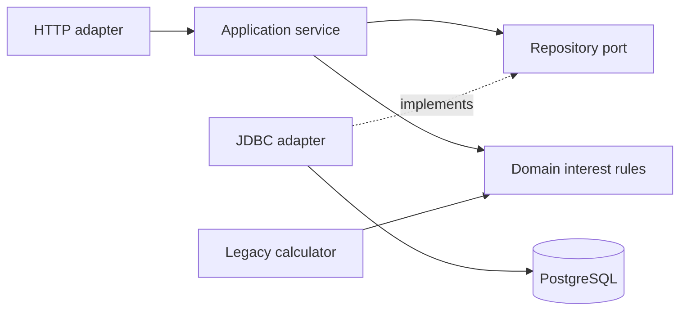

# Java time deposit application

## Solution overview

The [assignment](../README.md) supplied a legacy Java interest calculator and asked for a database-backed API. This solution lists deposits with their withdrawals through `GET /time-deposits` and applies one month of interest through `POST /time-deposits/interest`. The legacy calculator now delegates to shared domain interest rules. PostgreSQL stores the balances and withdrawal records.

## Technology stack

| Component | Version and role |
| --- | --- |
| Java and Maven | Java 17 and Maven 3.9.16 for the verified build. |
| Spring Boot and Spring JDBC | Boot 3.5.16 wires HTTP, dependency injection, and transactions. JDBC 6.2.19 keeps the join, row locks, and batch writes explicit. |
| PostgreSQL and Flyway | PostgreSQL 17.12 stores decimal balances and coordinates row locks. PostgreSQL JDBC 42.7.11 and Flyway 11.7.2 manage access and schema migrations. |
| Docker Compose and Testcontainers | Verified with Docker Engine 29.9.3 and Compose 5.7.1. Testcontainers 1.21.4 runs integration tests against the same PostgreSQL image used by Compose. |
| JUnit, AssertJ, and JaCoCo | JUnit Jupiter 5.12.2, AssertJ 3.27.7, and JaCoCo 0.8.12 verify behavior and report coverage. |
| OpenAPI | A checked-in OpenAPI 3.0.3 YAML file describes the two HTTP operations. |

Spring Boot, JDBC, PostgreSQL, and Flyway were implementation choices. The assignment leaves framework selection open and lists OpenAPI, Hexagonal Architecture, and Testcontainers as preferences.

## Architecture



The domain holds the interest rules and JDK-only models. The application service coordinates reads and the interest transaction through the repository port. The JDBC adapter implements the port, and the HTTP adapter maps application results to response records.

`TimeDeposit` keeps its original constructor and methods. `TimeDepositCalculator` keeps its public no-argument constructor and `void updateBalance(List<TimeDeposit>)`, which still mutates the supplied objects. Both the legacy calculator and the application service call `TimeDepositInterest.calculateMonthlyInterest`.

## Business rules

| Plan key | Annual rate | Eligible days |
| --- | ---: | --- |
| `basic` | 1% | Day 31 onward |
| `student` | 3% | Days 31 to 365 inclusive |
| `premium` | 5% | Day 46 onward |

Plan keys are case-sensitive. Unknown non-null keys earn zero interest. An eligible update multiplies the current principal by the annual rate, divides by 12, rounds the interest to two decimal places with `HALF_UP`, and adds it to the principal. Repeated successful updates use the latest balance. To add a plan with the same formula, add its key, rate, and eligibility rule to the immutable table in [TimeDepositInterest.java](src/main/java/org/ikigaidigital/TimeDepositInterest.java), then cover its boundaries.

## Prerequisites

- JDK 17 and Maven
- A running Docker engine with Docker Compose that supports `up --wait`

## Build and test

Run from the repository root.

```sh
mvn -f java/pom.xml clean verify
```

Testcontainers starts PostgreSQL 17.12 and Flyway applies the application migration in each integration suite. Open `java/target/site/jacoco/index.html` after verification. The executable JAR is `java/target/time-deposit-kata-1.0-SNAPSHOT.jar`.

## Run locally

Run from the repository root. If a default port is occupied, set the overrides below before starting.

```sh
docker compose -f java/compose.yaml up -d --wait
mvn -f java/pom.xml clean verify
java -jar java/target/time-deposit-kata-1.0-SNAPSHOT.jar
```

Flyway applies the schema at startup. After the app has started, optionally load the sample SQL once in a second terminal. It inserts six deposits and three withdrawals with fixed IDs in one transaction.

Linux or macOS

```sh
docker compose -f java/compose.yaml exec -T postgres psql -U time_deposit -d time_deposit -v ON_ERROR_STOP=1 < java/db/sample-data.sql
```

PowerShell

```powershell
Get-Content -Raw -LiteralPath java/db/sample-data.sql |
    docker compose -f java/compose.yaml exec -T postgres psql -U time_deposit -d time_deposit -v ON_ERROR_STOP=1
```

Stop the app with `Ctrl+C`, then stop PostgreSQL with `docker compose -f java/compose.yaml stop`. The named volume retains its data.

### Configuration

| Setting | Default and purpose |
| --- | --- |
| `SERVER_PORT` | HTTP port `8080`. |
| `SERVER_ADDRESS` | HTTP bind address `127.0.0.1`. |
| `TIME_DEPOSIT_DB_PORT` | Published PostgreSQL port `5432` and the port used by the default JDBC URL. Set the same value for Compose and the application. |
| `SPRING_DATASOURCE_URL` | `jdbc:postgresql://localhost:5432/time_deposit` with the default database port. |
| `SPRING_DATASOURCE_USERNAME` / `SPRING_DATASOURCE_PASSWORD` | `time_deposit` / `time_deposit_dev`, for local development. Compose uses these same defaults for its `time_deposit` database. |

To use database port `15432` and HTTP port `8081`, run the following before startup in the terminal that starts Compose and the app.

```sh
export TIME_DEPOSIT_DB_PORT=15432
export SERVER_PORT=8081
```

```powershell
$env:TIME_DEPOSIT_DB_PORT = '15432'
$env:SERVER_PORT = '8081'
```

Use the chosen HTTP port in the requests below. The default HTTP and PostgreSQL listeners are loopback only. The unauthenticated API and development credentials are scoped to local assessment use.

## API usage

Paste the contents of [openapi.yaml](openapi.yaml) into Swagger Editor, or import the file into an OpenAPI client that can reach localhost. Select the local server, run the GET operation, then send the POST operation with an empty request body. If you changed `SERVER_PORT`, update the server URL in the client or your local copy of the contract. If browser access to localhost is restricted, use the terminal commands below. [Swagger Editor](https://swagger.io/open-source/swagger-editor/)

```sh
curl --include http://localhost:8080/time-deposits
curl --include --request POST http://localhost:8080/time-deposits/interest
curl --include http://localhost:8080/time-deposits
```

In Windows PowerShell, use `curl.exe` in place of `curl`.

**`GET /time-deposits`** returns `200 OK` and a JSON array. These are two entries from the freshly loaded sample database.

```json
[
  {
    "id": 102,
    "planType": "basic",
    "balance": 2400.00,
    "days": 31,
    "withdrawals": [{"id": 201, "amount": 20.00, "date": "2026-11-01"}]
  },
  {"id": 103, "planType": "student", "balance": 6.00, "days": 365, "withdrawals": []}
]
```

An empty database returns `[]`. The enclosing deposit supplies the ID for its nested withdrawals.

**`POST /time-deposits/interest`** returns `204 No Content` with zero body bytes, including with an empty database. After one POST, the sample Basic, Student, and Premium balances for IDs `102`, `103`, and `106` read `2402.00`, `6.01`, and `4820.00` in the next GET.

## Database design

The [Flyway migration](src/main/resources/db/migration/V1__create_time_deposit_tables.sql) maps the assignment's logical names `timeDeposits`, `planType`, and `timeDepositId` to `time_deposits`, `plan_type`, and `time_deposit_id`. A deposit has zero or more withdrawals. Both tables have integer primary keys, and the required withdrawal foreign key is indexed.

The remaining fields are required. Monetary amounts use PostgreSQL `NUMERIC` without a fixed scale and Java `BigDecimal`. Withdrawal dates use `DATE` and Java `LocalDate`. One ordered join returns deposits and withdrawals by ID, including deposits with empty withdrawal collections.

## Assumptions and trade-offs

- **Rates and eligibility.** The original calculator establishes the annual-rate interpretation and the inclusive 365-day Student cutoff. The API uses the stored day count. The stored balance is the interest principal, and withdrawal records are informational for this calculation.
- **Legacy rounding.** The domain still computes interest with binary `double` before rounding at the cent. A Student balance of `6.00` produces a value just below `0.015` and earns `0.01`. The service converts the principal only for the interest calculation and adds the rounded amount to the original `BigDecimal`, retaining fractional principal digits.
- **Monetary range.** A principal that converts to a non-finite `double` fails the batch before writes. Values tiny enough to convert to zero earn no cent-sized credit and retain their principal. PostgreSQL special numeric values such as `NaN` and infinities are outside the monetary domain. A sufficiently large finite principal can exceed the legacy calculation range after a credit.
- **Transactions and retries.** One `READ COMMITTED` transaction locks deposits by ID with `SELECT FOR UPDATE`, calculates and writes the batch, and rolls back on failure. A waiting update reads the committed balance before calculating. A deposit inserted after the locking query starts may first participate in the next batch. Each successful POST intentionally applies another month of interest.
- **Deployment.** The API is local and unauthenticated. A network deployment requires authentication, authorization, TLS, and a supported dependency line. Spring Boot 3.5.16 was the final open-source release of the 3.5 line. [Spring Boot release announcement](https://spring.io/blog/2026/06/25/spring-boot-3-5-16-available-now/)

## Verification

The submission build passed **52 tests with zero failures, errors, or skipped tests**. JaCoCo reported **93/95 lines (97.9%)** and **24/24 branches (100%)**. The two executable lines missed by JaCoCo are in `main`. The packaged JAR was started separately for a smoke test.

| Group | Cases | What they check |
| --- | ---: | --- |
| Domain | 30 | Legacy rates, cutoff boundaries, mutation, repeated updates, and half-cent rounding. One test also verifies the refactored interest method leaves the deposit untouched. |
| PostgreSQL repository | 15 | Schema constraints, decimal and date mapping, ordering, transaction requirements, rollback, and locking. |
| Application and HTTP | 7 | Response contracts, empty and mixed batches, exact principal preservation, repeat calls, rollback after a partial write, unsupported conversion, and two overlapping POSTs. |

The concurrent test checks two competing requests on one deposit. The release checks also validated OpenAPI and exercised the GET, POST, and follow-up GET from the packaged JAR against an isolated Compose database.

## AI-assisted development

See the [repository agent instructions](../AGENTS.md) and the [AI workflow and verification record](AI_WORKFLOW.md) for the prompts, decisions, and approval boundaries.
